# What is Worklog Helper for Jira

A Chrome side panel that makes everyday Jira work faster. Create tasks, log hours and see your own hours in one place, without clicking through several screens.

- **Create tasks** with title, parent, sprint, priority, dates and estimate.
- **Log hours** when you create a task, or later on any existing task, with a date, start time, note and status update.
- **See "My hours"** for any date range, with sub-tasks included.
- **Review before anything is sent.** Nothing reaches Jira until you press Confirm.
- **Uses the Jira login you already have** in Chrome. No password or API token to paste.
- Light and dark themes.

Works with Jira Cloud (`yourcompany.atlassian.net`) in Google Chrome 114 or newer.

Current version: **1.1.1** ([changelog](CHANGELOG.md)). Short version for the team: [Quick Guide](docs/QUICK_GUIDE.md).

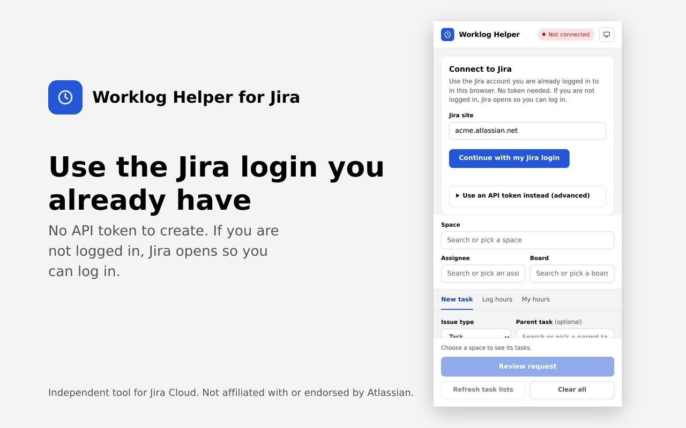

## Install (once, about 2 minutes)

1. **Download** the zip from the [downloads](downloads/) folder (open the file, then click the download button) and **unzip** it into a folder you will keep, for example Documents.
   - [`worklog-helper-for-jira.zip`](downloads/worklog-helper-for-jira.zip): for any other Jira Cloud site. You type your site name when you connect.
2. In Chrome, open `chrome://extensions` and turn on **Developer mode** (top right).
3. Click **Load unpacked** and select the folder that has `manifest.json` directly inside.
4. Click the puzzle icon in the toolbar and **pin** Worklog Helper for Jira.
5. Click the icon to open the side panel.

> Chrome may show a "Disable developer mode extensions" message when it starts. Close the message and keep the extension on.

## Connect to Jira

Click **Continue with my Jira login**.

- If you are already logged in to Jira in this Chrome, the panel shows **Connected** right away.
- If you are not logged in, a Jira login page opens. Log in, go back to the panel and click **Continue** again.
- The public version asks for your Jira site first, for example `yourcompany.atlassian.net`, and Chrome asks you to allow access to that one site.

Prefer a token? Open **Use an API token instead (advanced)** in the same screen. This is only needed if the Jira login does not work for you.

## How to use

### Choose your Space, Assignee and Board

Pick your **Space** at the top. **Assignee** and **Board** are optional. They apply to every tab. Hours are always logged as you.

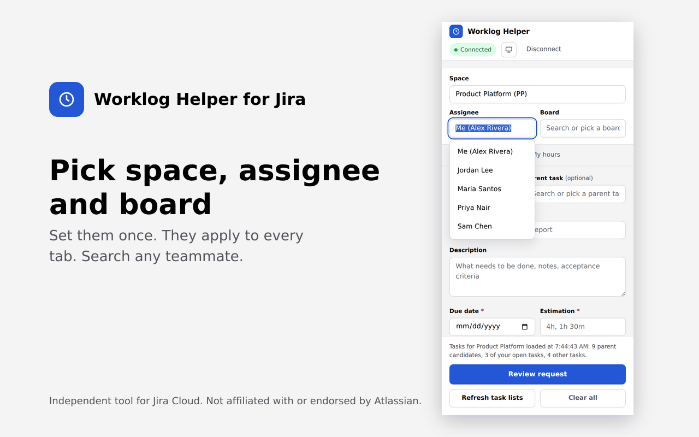

### Create a task

Open the **New task** tab. Title, Due date and Estimation are required.

Search the **Parent task** by title. Your own tasks are listed first.

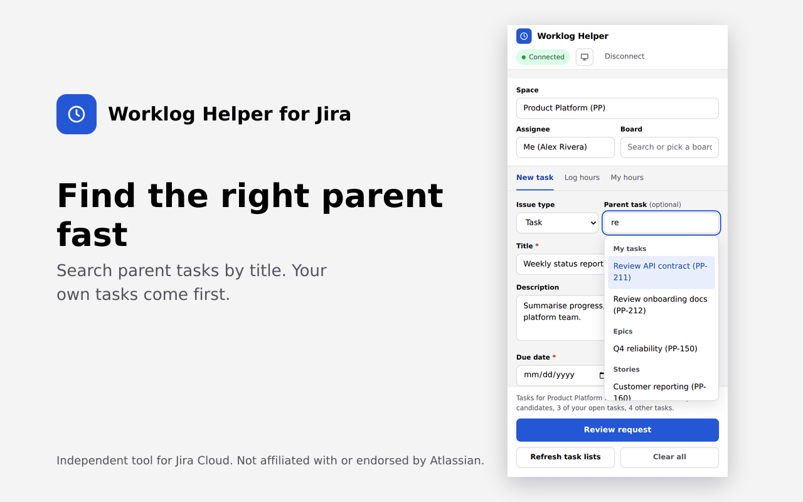

Open **More details** for Sprint (default None), Status, Priority and Start date.

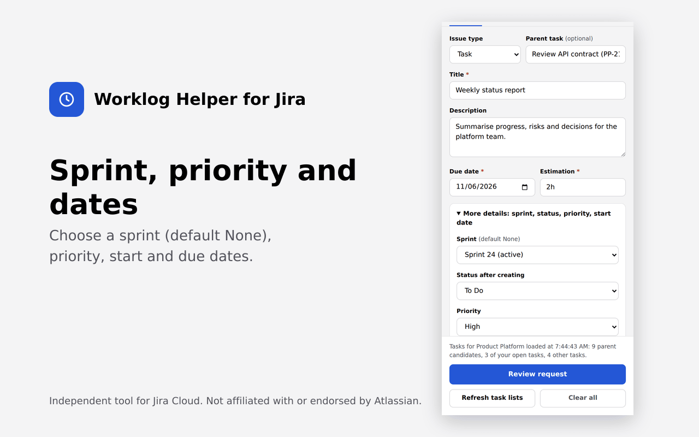

Switch on **Log hours on creation** to log time at the same moment. Add hours, date, start time and a note. The note can have several lines.

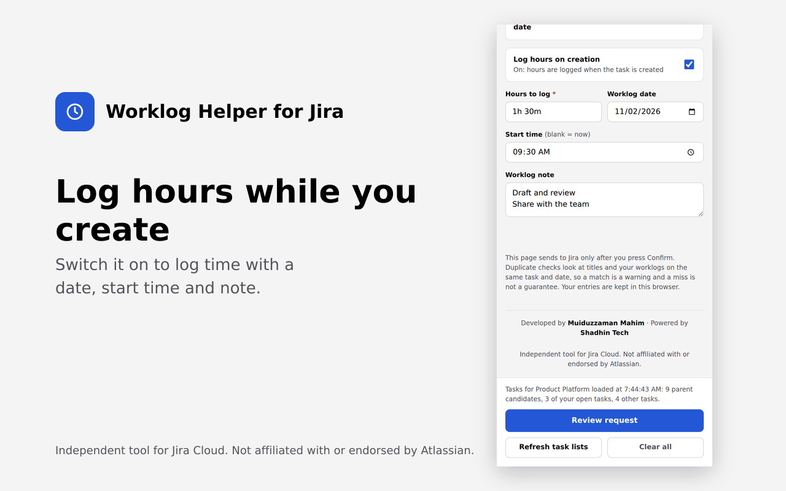

### Review, then send

Click **Review request**. You see every change that will happen, with duplicate warnings in red. Items with a warning start unticked. Tick them only if you really want them sent, then click **Confirm and send to Jira**.

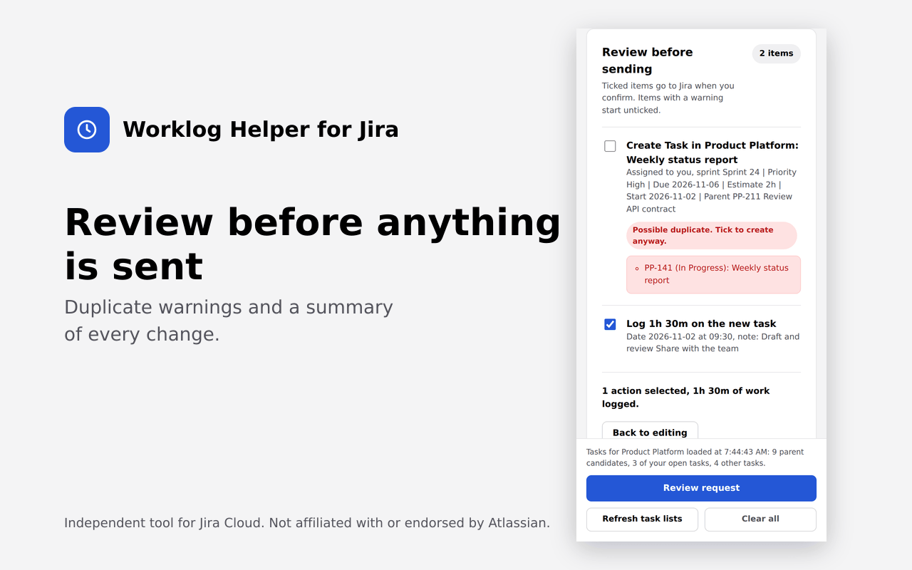

Each step shows its result, with a link to open the new task in Jira.

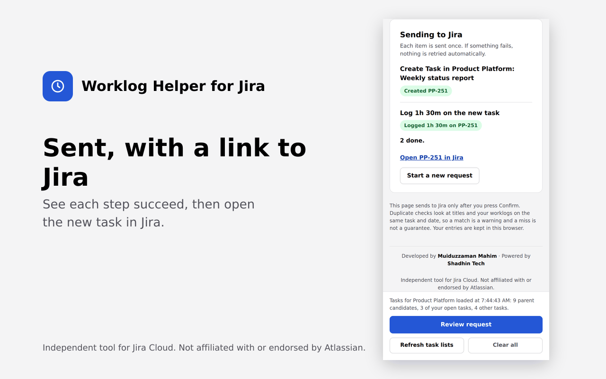

### Log hours on existing tasks

Open the **Log hours** tab. Pick the task, enter Hours (for example `1h 30m`) and the date. Start time is optional. **Update task status** shows only the statuses Jira allows for that task. Add a note if you like. Use **Add another task** for more rows.

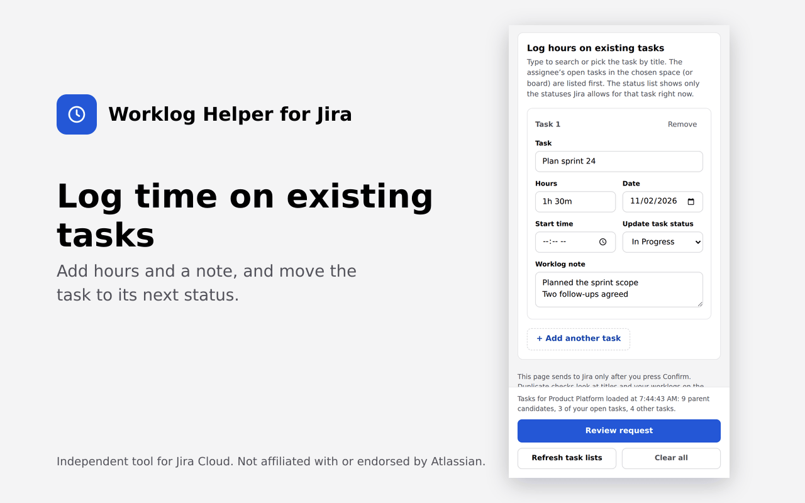

Type to search tasks by title. Your open tasks come first. If you picked a board, the list narrows to that board.

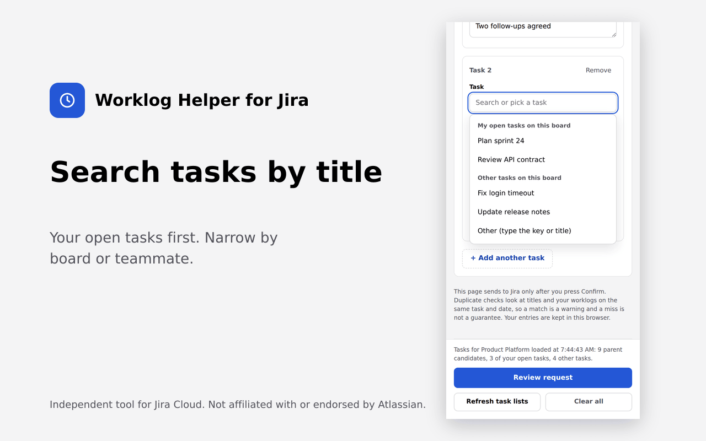

### See your hours

Open **My hours**. Choose This week, Last week, Last 7 days, This month, Last month or your own dates, then click **Show my hours**.

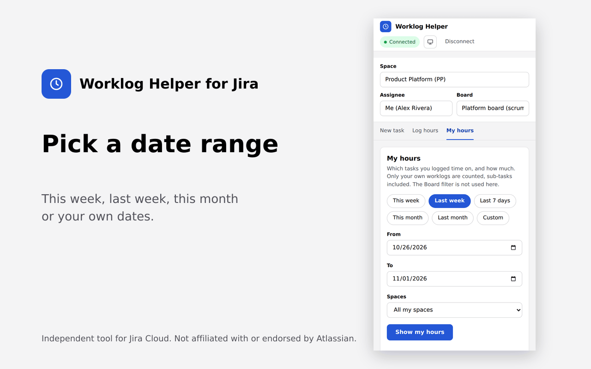

You see your total and every task you logged time on, with sub-tasks and their parent. Only your own worklogs are counted. **Copy** puts the table on your clipboard for a spreadsheet.

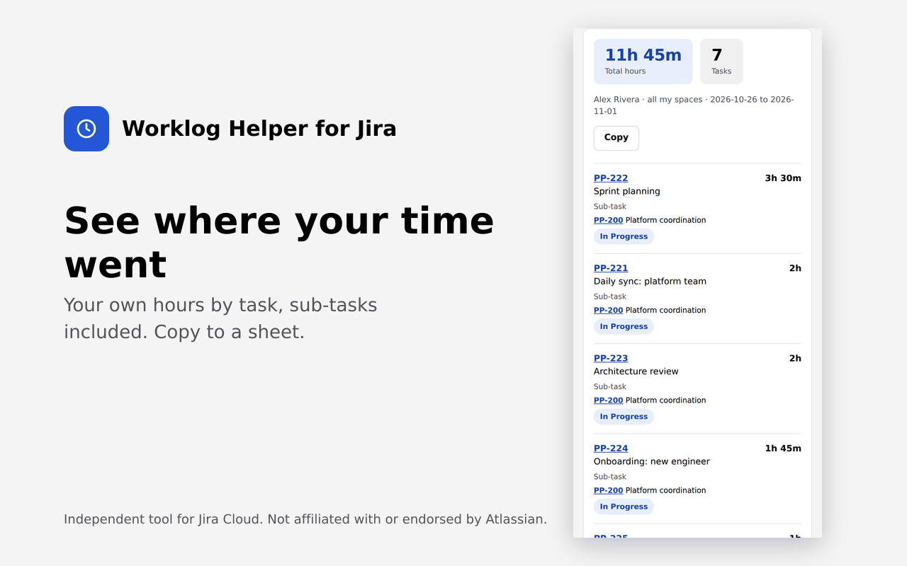

### Light and dark

Use the sun or moon icon at the top to switch between System, Light and Dark.

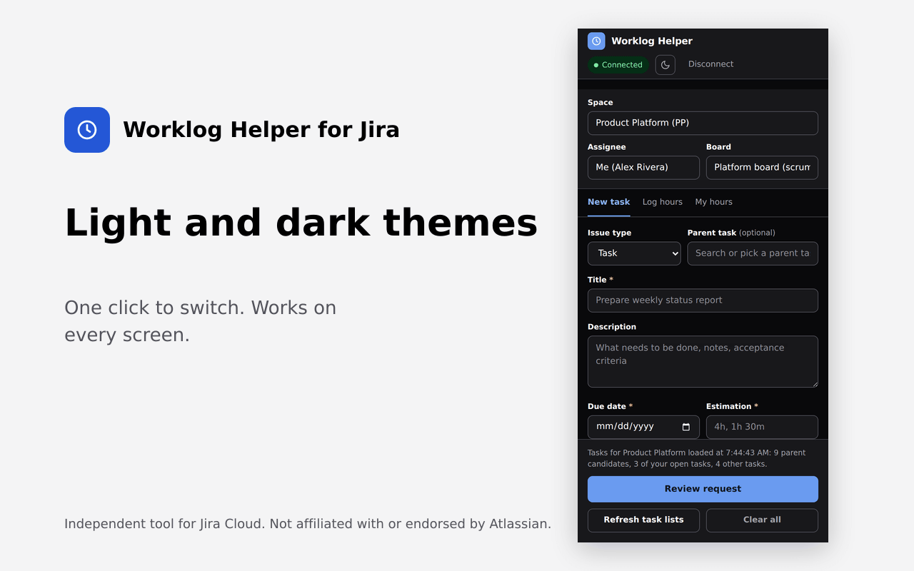

## Update to a new version

1. Download the new zip and unzip it anywhere, for example Downloads.
2. Copy all the files into your install folder and choose **Replace the files in the destination**.
3. Open `chrome://extensions` and click the **reload** icon on Worklog Helper for Jira.

Update in the same folder you installed from. Chrome remembers that folder, so your connection and settings stay. If you load a different folder, Chrome treats it as a new extension and you connect again.

## Privacy and security

- There is **no server, no analytics and no tracking**. The extension talks only to your own Jira site.
- It first calls Jira with the login your browser already has. If Jira does not accept that, it runs the request inside your own Jira tab, the way Jira's own pages do. Your password and cookies are never read.
- With the optional API token, the token is kept for the browser session only unless you choose **Keep me signed in on this device**.
- **Disconnect** removes the saved connection and any unsent form text.
- A strict content security policy allows only the extension's own scripts and connections to `*.atlassian.net`.

| Permission | Why |
| --- | --- |
| `sidePanel` | Shows the helper in Chrome's side panel. |
| `storage` | Keeps your Jira site, the connection mode and unsent form text in your browser. |
| `scripting` | Fallback that runs requests inside your own Jira tab, only when Jira does not accept a direct call. |
| Access to `*.atlassian.net` | Lets the extension reach your Jira site. The public version asks for the one site you enter. |

## Troubleshooting

| If you see | Do this |
| --- | --- |
| "Manifest file is missing or unreadable" when loading | You picked the wrong folder. Select the folder that directly contains `manifest.json`. |
| The panel says it is not connected | Log in to Jira in a Chrome tab, then click **Continue with my Jira login**. |
| Task lists are empty or old | Click **Refresh task lists**. |
| Hours or a task are missing in My hours | Check the date range and the Spaces setting, click **Show my hours** again, then report the task key (see Feedback). |
| The extension is gone after a restart | The folder was moved or deleted. Put it back and use **Load unpacked** again. |

## Feedback

Tried it? Please tell us what works, what is confusing and what is missing. Bugs and ideas are both welcome.

- Open an [issue](../../issues/new/choose) in this repository (there are short templates for a bug and for feedback), or message Muiduzzaman Mahim directly.
- For a bug, please include the task key, the date range you chose and what you expected to see.

## Credits and notices

Developed by **Muiduzzaman Mahim**, powered by **Shadhin Tech**.

Copyright (c) Muiduzzaman Mahim. All rights reserved.

Worklog Helper for Jira is an independent tool. It is not affiliated with, endorsed by or sponsored by Atlassian. Jira and Atlassian are trademarks of Atlassian.
